  

  

  
  
  
  

## 👨‍💻 About me

I'm a **backend / full-stack engineer** who likes the parts of a system that have to be right: authentication, money math, and the plumbing between services.

- 🔐 Building **auth and API gateway** infrastructure: token rotation, rate limiting, circuit breakers
- 💸 Writing **money-safe backends** with integer-cent math and tested settle-up logic
- ☁️ Shipping with **Docker** and **Terraform** on **AWS**
- 🌱 Currently: finishing the Split Money frontend and adding observability to my API gateway

## ⚡ What I can do

## 🚀 Featured work

| | Project | What it is | Stack |
|:-:|---|---|---|
| 🛡️ | **[distributed-api-gateway-auth](https://github.com/mayurbagul03/distributed-api-gateway-auth)** | API gateway that centralizes auth for microservices: refresh-token rotation with replay detection, two-tier revocation, Redis sliding-window rate limiting, per-service circuit breakers, HMAC-signed identity headers | Node 20 · Express · MySQL · Redis · JWT · Docker |
| 💸 | **[Split-money](https://github.com/mayurbagul03/Split-money)** | Mobile-first trip expense splitter: integer-cent math with largest-remainder rounding, equal / exact / share splits, minimum-payment settle-up | React · TypeScript · Express 5 · Prisma · PostgreSQL |
| 🩺 | **[healthcare-SSI](https://github.com/mayurbagul03/healthcare-SSI)** | Self-sovereign identity demo: a university issues a doctor a verifiable credential and patients verify it against the ledger | Hyperledger Indy · ACA-Py · FastAPI · React |
| 🔑 | **[auth-service-argon2](https://github.com/mayurbagul03/auth-service-argon2)** | Standalone authentication service with Argon2 password hashing | Node.js · Express |
| ☁️ | **[terraform-s3bucket](https://github.com/mayurbagul03/terraform-s3bucket)** | S3 infrastructure as code | Terraform · AWS |

## 🧰 Tech I use

  
  
  
  
  
  
  

  
  
  
  
  
  
  

  <b>Let's build something reliable together.</b> Reach out about backend roles, auth/security work, or anything distributed. 🤝

